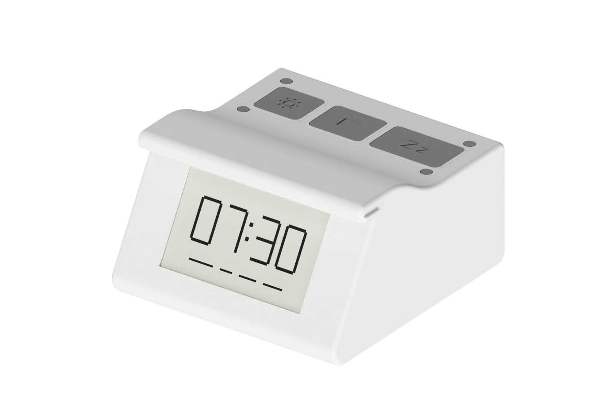
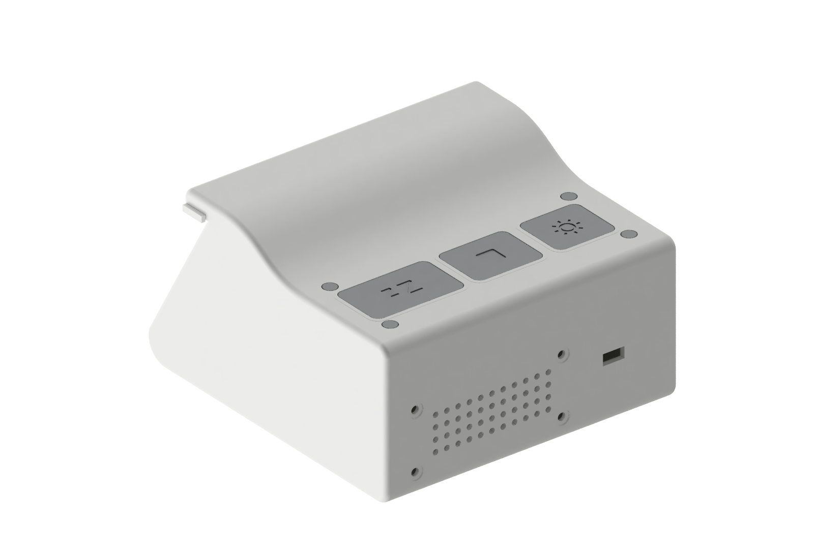

# Clockinator

**A smart alarm clock synced with your phone, so you can leave your phone outside the bedroom.**

Clockinator helps you put your phone down in the evening and get out of bed in the morning. Set your routines in the Android app, synchronize the clock, and leave your phone at its charging spot. The clock can ring in the bedroom while the phone stays elsewhere.

A routine has a **Focus** time, an optional **Bedtime** reminder, and a **Wake-up** alarm. Two NFC tags help anchor the routine: one where you leave your phone, another where you start your day. Physical Stop and Snooze buttons remain available on the clock.

No account or cloud service is required. The app and clock communicate over Bluetooth, with optional local Wi-Fi. After synchronization, the powered clock follows its schedule without a continuous phone connection. After a clock restart, reconnect the phone to restore time and routines.

> **Work in progress.** The enclosure and electronics are prototypes; the complete hardware setup has not yet been validated. Images below are CAD renders, not photographs of an assembled product.

## The clock

| Front | Rear |
| --- | --- |
|  |  |

The v3 enclosure combines a 3.7-inch e-paper display, a speaker, three keys and a light diffuser. A separate [phone dock](case-dock/README.md) can hold the phone, a Qi charging module and an NFC tag.

## Documentation

| I want to… | Guide |
| --- | --- |
| Understand routines, NFC, synchronization and offline behaviour | [How it works](docs/how-it-works.md) |
| Choose parts, wire and assemble the clock | [Build guide](docs/build-guide.md) and [v3 bill of materials](case-v3/BOM.md) |
| Print the enclosure and controls | [Print settings and orientation](docs/printing.md) |
| Build and use the Android app | [Android app](docs/android.md) |
| Compile and flash the ESP32 | [Firmware](docs/firmware.md) |
| Run the existing software checks | [Development and tests](docs/development.md) |

## Source and design files

- [`android/alarm_controller/`](android/alarm_controller/): Android app, Kotlin and Jetpack Compose.
- [`esp32/clockinator/`](esp32/clockinator/): ESP32 Arduino firmware.
- [`case-v3/`](case-v3/): current enclosure, CAD scripts, renders and printable parts. See the [export status](case-v3/output/README.md) before using the native Fusion archive.
- [`case-v2/`](case-v2/): earlier enclosure prototype.
- [`case-dock/`](case-dock/): phone dock.

The [UI design notes](docs/design/parcours-et-interface.md) and [interactive mockup](docs/design/prototype.html) document the interface direction implemented in the Android app. The HTML mockup uses sample data and is not an app screenshot.

## License

[MIT](LICENSE).
