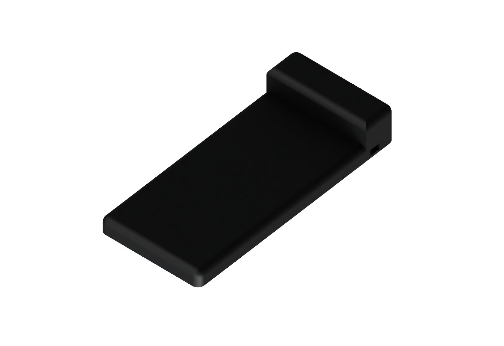
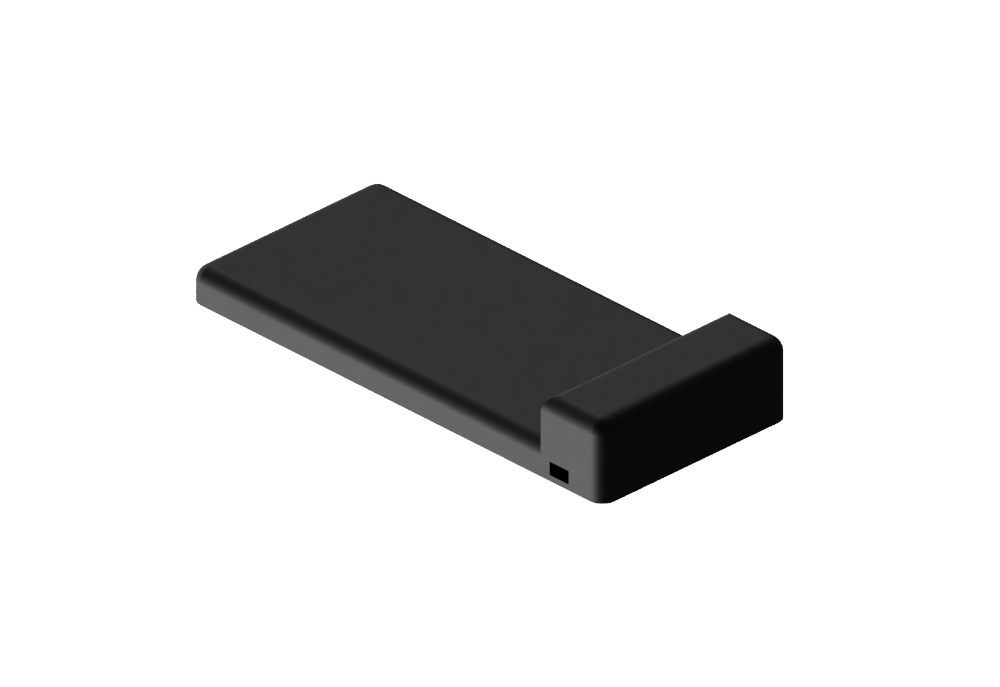

# Phone dock (Qi coil + NFC tag) - prototypes

> **Work in progress.** The dock is still under development. Not all parts have been printed, assembled or tested, and charging, NFC operation and fit with the actual modules still require validation. The images are CAD renders, not photographs of an assembled dock.

The current version is the **horizontal L-shaped dock**, Fusion document `phone dock - L`. The earlier inclined prototypes are retained below for reference.

## Current L version: files and reproduction

- `fusion-work/build_dock_L.py` builds the L dock, including the four corrected foot pockets on the underside cover.
- `fusion-work/export_dock_L.py` exports the current open L dock, preserving its existing Fusion edits, and checks the pocket positions and depths before export.
- `fusion-work/verify_dock_exports.py` checks the two exported STL meshes and the Fusion archive.
- `fusion-work/render_dock_L.py` prepares a matte-black copy on a white background, without the phone or internal reference components. Run `render_queue.py` next to frame the committed geometry and queue the two local Fusion renders; `render_status.py` reports their progress. The working model is not recoloured.

Latest parts: [body STL](output/dock-L-body.stl), [bottom-cover STL](output/dock-L-bottom-cover.stl), [Fusion assembly](output/dock-L-assembly.f3d), [STEP parts](output/dock-L-parts.step). STL dimensions are in millimetres and retain the original model coordinates: X across the dock, Y upwards, Z along the phone. Orient the parts and inspect support requirements in the slicer before printing.

To reproduce, run the build script in a new Fusion design, then run the export script in a separate script invocation after the model is committed. To export a manually edited version, open that version and run only the export script. Run the mesh verifier with `python case-dock/fusion-work/verify_dock_exports.py` from the repository root.

### Rubber feet

Use four adhesive feet, **8 mm diameter and 2 mm high**. The seats are **8.4 mm diameter and 1 mm deep**, so the feet protrude by 1 mm. They are on the **large underside cover, on the same face as the six screw heads**, not on the block's end/side face.

Pocket centres in model coordinates are X = ±33 mm, Z = −14 and 146 mm; their axes run along Y. They clear all six screw recesses. The 1.8 mm cover retains 0.8 mm of material at each pocket. The corrected generator was rebuilt separately and reproduced both live Fusion parts; the geometry checks do not replace a print and physical assembly test.

The electronics cavity is clipped to a 1.2 mm inset of the rounded exterior. This keeps the cavity from breaking through the rounded corners. The STL meshes pass the closed-mesh check.

## Earlier inclined prototype

Script: `fusion-work/build_dock.py`. STL: `output/dock-body.stl`, `output/back-cover.stl`. The following assembly instructions and dimensions apply to this earlier inclined design, not the L version.

## Capacitor

No need to desolder it. The PCB sits in a tray on the floor and the capacitor stands up in the open cavity (the dock is about 140 mm tall, so there is plenty of room). Desolder only if your capacitor is taller than ~35 mm.

## Assembly

1. Print the body face-down (phone face on the bed) and the cover flat.
2. Slide the 4 M3 nuts into the side slots from inside the body.
3. Stick the coil and the NFC tag with tape against the inside of the thin 1.2 mm skin, positioned for your phone (the model has no seat for them, only reference positions).
4. Drop the PCB in its tray, micro-USB towards the rear opening in the cover; route coil wires to the PCB.
5. Close with the cover and 4 M3 x 6 screws.

## Assumptions to check (sizes are guesses)

- Coil 50 mm diameter, about 3 mm thick; tag 25 mm, 1 mm thick; PCB 41 x 14 x 2 mm; capacitor 10 mm diameter.
- Phone 11 x 75 x 155 mm, leaning at 70 degrees from horizontal on a 12.7 mm deep ledge with a front lip 8 mm high; no side guides.
- Circuit board: held down with tape or a small dab of neutral silicone (no mechanical retention).
- Interference check against the reference bodies: none. No test print.

## Bill of materials

- 4 x M3 x 6 screws, 4 x M3 nuts, Qi coil (50 mm), Qi driver PCB with micro-USB, NFC tag (25 mm), micro-USB cable.

## Smooth version (inclined)

`fusion-work/build_dock_smooth.py` rounds the inclined dock like the clockinator v3. STL: `output/dock-body-smooth.stl`, `output/back-cover-smooth.stl`. The cover screws were moved inwards (x = +-34 mm) so no hole breaks the top rounding.

## L version (horizontal) - prototype

`fusion-work/build_dock_L.py`, Fusion document "phone dock - L". STL: `output/dock-L-body.stl`, `output/dock-L-bottom-cover.stl`.

- The phone lies flat on a 12 mm platform (172 mm long, 90 mm wide); its bottom edge touches the upright block (30 mm high) that holds the Qi driver PCB and the tall capacitor.
- The coil (reference at z = 85 mm) and NFC tag (z = 150 mm) are taped under the 1.2 mm top skin; move them to suit your phone.
- Everything is loaded from below. The bottom cover carries the PCB tray, so the PCB is mounted on the cover and slid in with it. The micro-USB port faces the right side wall: 2.4 mm wall, plug body stays outside.
- The bare Qi PCB measures **41 × 20 mm**. The tray has **21 mm of clear width** between its guides, and the tray and micro-USB opening were shifted together by 3 mm to clear the existing screw columns. At the end opposite micro-USB, a 3 mm return on the inner guide and a 5 mm return on the outer guide leave a **13 mm opening for the soldered wires**. The insertion was checked in CAD; physical fit remains to be tested.
- 6 x M3 x 6 screws and 6 M3 nuts (nuts slide in from the cavity). Check the orientation and supports in the slicer: the raised electronics block and the phone platform are not coplanar. No print orientation has been physically validated yet.
- Four 8 x 2 mm adhesive feet fit into 8.4 x 1 mm pockets on the underside cover, alongside the screws. These leave the screws accessible.
- Interference check against phone, coil, tag, PCB and capacitor: none. No test print.
