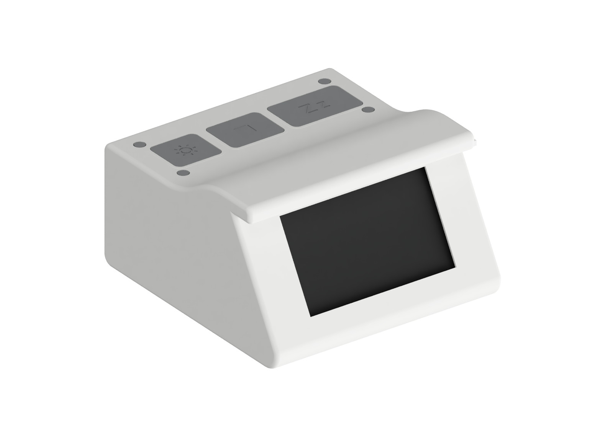
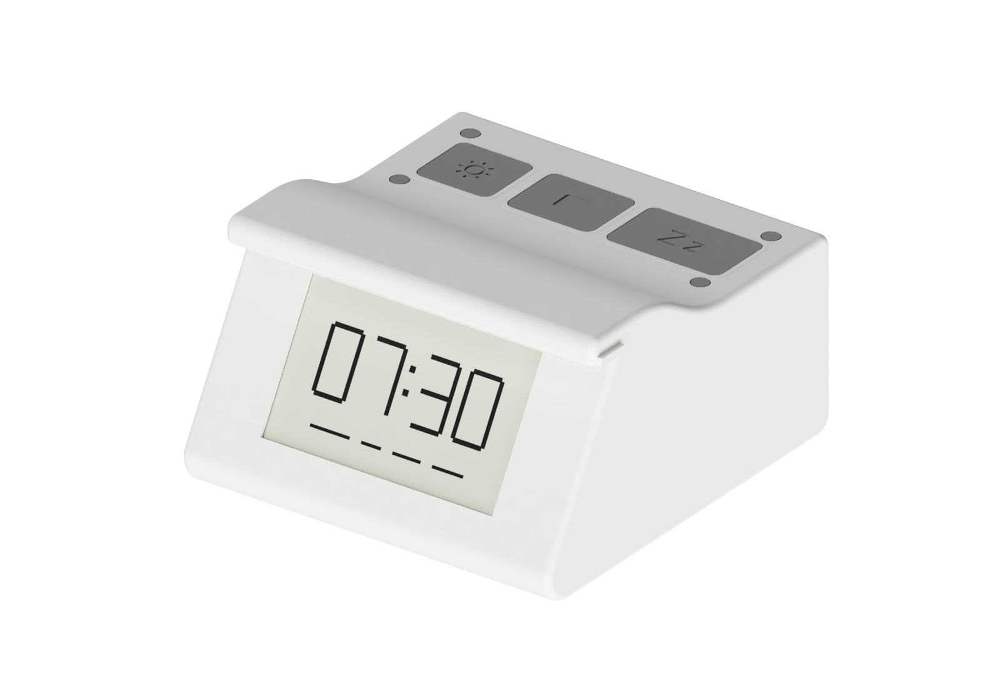
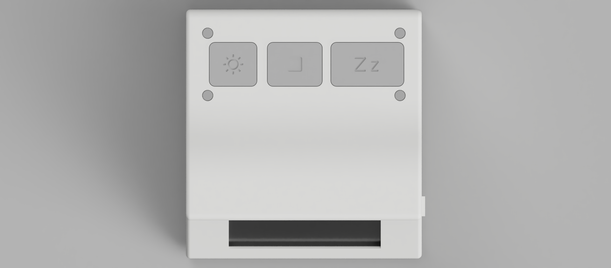
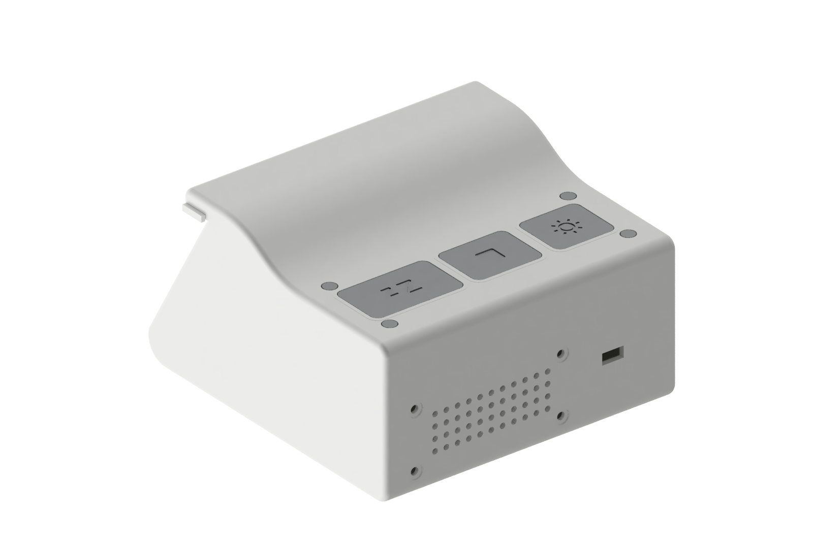
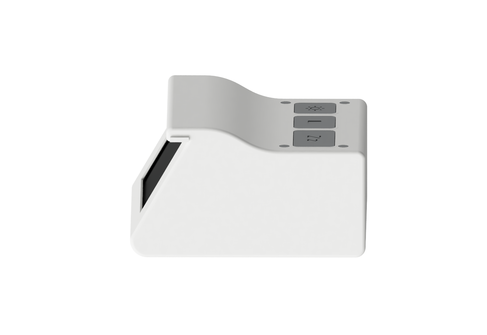
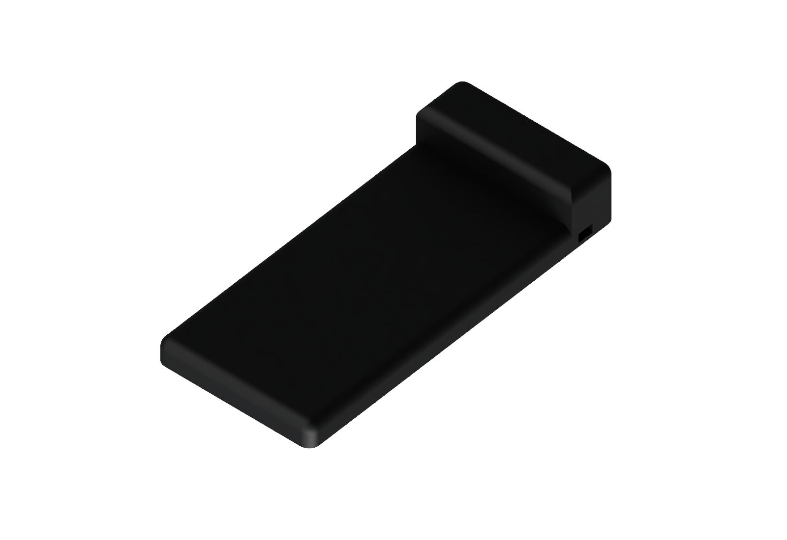
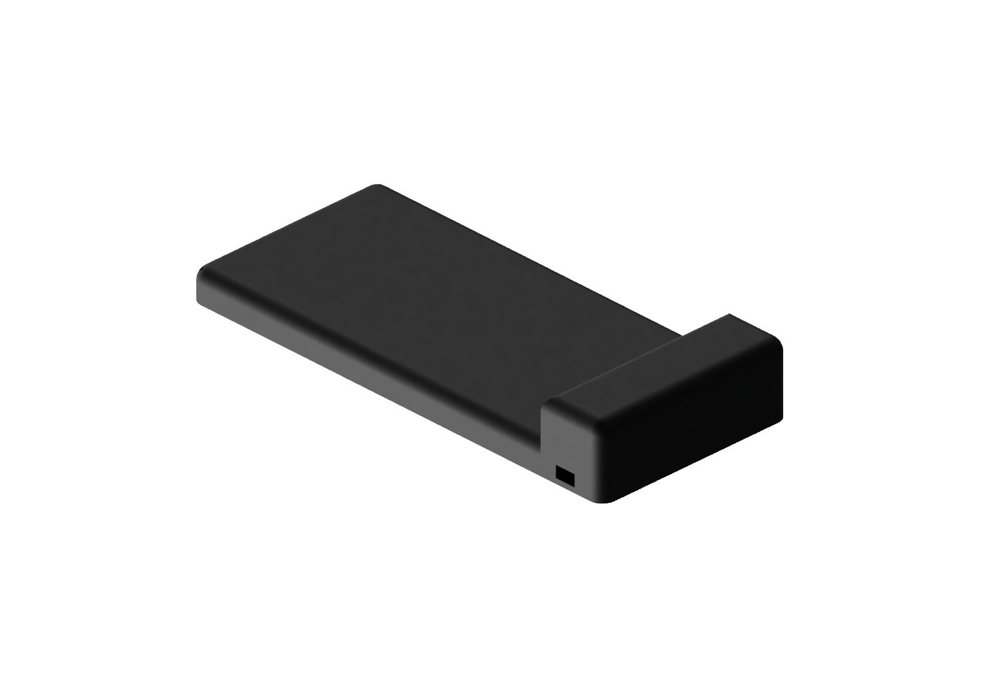

# Build guide

[Back to the project](../README.md) · [Print settings](printing.md) · [Flash the firmware](firmware.md)

This is a prototype assembly guide. The full hardware setup has not yet been validated. Confirm fit and module dimensions before printing the complete set.

## Hardware

The firmware is intended for a compatible ESP32 board connected to:

- a **3.7-inch GDEY037T03 black-and-white e-paper display**;
- an I²S audio amplifier and speaker;
- one or more NFC tags for the phone drop-off and morning checkpoints.

Pins defined by the firmware:

| Function | ESP32 GPIO |
| --- | ---: |
| E-paper CS | 5 |
| E-paper DC | 16 |
| E-paper RST | 17 |
| E-paper BUSY | 4 |
| I²S BCLK | 26 |
| I²S LRC / WS | 25 |
| I²S data to amplifier | 27 |

Check the power requirements and exact pinout of your modules before wiring. The repository does not prescribe a specific ESP32 board or amplifier model.

The v3 BOM models a 30-pin ESP32 WROOM board with USB-C, a MAX98357A amplifier
and three Gateron KS-33 switches. Its mounting assumptions must be checked
against the parts you actually buy.

### Buttons and light

| Function | Firmware wiring |
| --- | --- |
| Stop | GPIO32 to GND; internal pull-up enabled |
| Snooze | GPIO33 to GND; internal pull-up enabled |
| Light button | GPIO34 to GND, with an external pull-up to 3.3 V; currently disabled in firmware |
| RGB LED | Red GPIO13, green GPIO12, blue GPIO14; one series resistor per colour as listed in the BOM |

The default firmware uses `LIGHT_COMMON_ANODE = false`. Match the LED's common
connection and this constant to your actual LED. The optional light switch is
gated by `LIGHT_BUTTON_ENABLED`; it is not functional merely because its key
has been printed. The v3 BOM's light-sensor module is not integrated into the
enclosure or needed for the current light control.

## Assembly sequence

1. Check the [BOM](../case-v3/BOM.md), measure the actual display, board and speaker, and print fit-test parts using the [print guide](printing.md).
2. Build and [flash the firmware](firmware.md) before enclosing the electronics. Confirm the board starts and advertises over BLE.
3. With power disconnected, fit the ESP32, amplifier and speaker to their supports. Insert side-entry nuts before their access is obstructed. Screw lengths are model estimates; check engagement and clearance against the boards.
4. Wire the display, amplifier, switches and LED from the tables above and the module manufacturers' pinouts. Keep wires clear of the switch travel, screw columns and diffuser rail. The plate no longer has cable notches; route wires through the remaining enclosure volume.
5. Slide the display into its guides, prepare the switch plate and keys, and check that every key moves freely. The lid retains the display from above.
6. Fit one diffuser and its slot plug. Dry-fit the lid before fastening: verify the display, wiring, keys and LED do not obstruct closure.
7. The four M3 lid screws pass through lid and plate into the shell brackets. Tighten without crushing the plastic, then fit the adhesive feet.
8. Power the device, [pair the Android app](android.md), create a test routine and verify sound, Stop and Snooze. Check reconnect and power-cycle behaviour before relying on the clock for a morning alarm.

This sequence has not yet been validated on a complete physical assembly.

### Enclosure and phone dock prototypes

The current **v3 enclosure** has a removable lid, three low-profile keys, an e-paper window and a light diffuser. The [v3 bill of materials](../case-v3/BOM.md) lists electronics, fasteners and printable parts. [STL and CAD files](../case-v3/output/) include the shell, lid, switch plate, keys and diffuser variants. Fit, screw lengths, wiring and lighting still need validation on an assembled prototype.

These are **CAD renders of the v3 design**, not photographs of an assembled device.

| Front-left | Front-right |
| --- | --- |
|  |  |

| Top and controls | Rear | Side |
| --- | --- | --- |
|  |  |  |

The [v2 design files](../case-v2/output/) remain available for reference.

The horizontal L-shaped dock combines a phone platform with space for a Qi driver and an NFC tag. These black renders show the dock without a phone; the underside has four recessed seats for adhesive rubber feet. The [dock guide](../case-dock/README.md) covers the latest scripts, STL files and measurements that still need checking.

