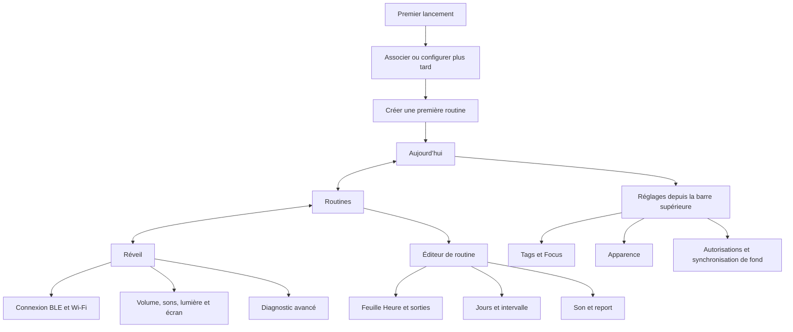

# Clockinator — proposition d’interface

Proposition fondée sur le code Android actuel, le 6 novembre 2026. La navigation à trois onglets, la palette, le choix d’apparence, les réglages regroupés et l’éditeur simplifié sont maintenant intégrés dans l’application. Ce document conserve le raisonnement de conception et les objectifs de validation ; il ne constitue pas une preuve de validation visuelle sur appareil. La [maquette interactive](prototype.html) utilise des données d’exemple, sans connexion au réveil.

## Point de départ avant intégration

`MainScreen.kt` orchestre six pages : accueil, connexion, réglages, configuration du réveil, première routine et éditeur. L’accueil liste les routines ; les accès au réveil et aux réglages sont des icônes dans la barre supérieure. Il n’y a pas de navigation inférieure.

`SettingsTab` réunit volume, Wi-Fi, tags NFC, Focus, fichiers WAV, lumière RGB, écran et synchronisation. `DeviceTab` mélange connexion, actions d’alarme et console de messages. `AlarmDialog` est déjà un écran complet malgré son nom : heures, sorties audio et récurrence sont visibles ensemble ; seul « Sound & snooze » se replie.

Le thème sombre est **déjà présent**, activé par `isSystemInDarkTheme()` dans `ui/theme/Theme.kt`. L’activité utilise ce thème sans le surcharger. Sur Android 12+, les couleurs dynamiques Material You sont activées par défaut et remplacent la palette de marque. Aucun choix d’apparence persistant n’est exposé dans les réglages. Les couleurs de statut sont fixes dans `Color.kt` et doivent être vérifiées dans les deux thèmes.

## Parcours et destinations

| Besoin | Parcours actuel | Proposition |
| --- | --- | --- |
| Première utilisation | Autorisations → scan BLE + Wi-Fi → première routine ; possibilité de passer | Présenter le bénéfice → associer le réveil en BLE → créer une routine ; Wi-Fi et tags proposés ensuite, sans bloquer la création |
| Vérifier la prochaine sonnerie | Lire les heures de chaque carte et les états BT/Wi-Fi | **Aujourd’hui** : prochain événement daté, sortie sonore, routine et état de synchronisation |
| Créer / modifier une routine | Bouton + → long éditeur | **Routines** → créer ou toucher une carte → frise Focus / Coucher / Réveil ; toucher une étape pour la régler |
| Choisir récurrence et exceptions | Daily/Weekly/Every N days ; boutons de saut et dialogue de pause | Jours visibles, intervalle dans « Autre rythme » ; distinguer « Passer cet événement », « Passer une fois la routine » et « Mettre en pause » |
| Arrêter / reporter une sonnerie | Bannière si le téléphone sonne ; commandes dans DeviceTab ; boutons physiques | Commande globale accessible depuis chaque destination ; indiquer explicitement si l’état vient du téléphone ou du réveil |
| Installer ou changer de réseau | Connexion BLE puis formulaire Wi-Fi dans les réglages | **Réveil → Connexion** ; expliquer que BLE est nécessaire pour transmettre les identifiants |
| Choisir / envoyer un son | Import dans les réglages puis nom du fichier saisi dans l’éditeur | Bibliothèque dans **Réveil → Sons** ; sélecteur de sons dans une routine, avec mélodie intégrée et import ; jamais saisir un nom de fichier à la main |
| Régler volume et lumière | Sections longues et trois champs RGB | **Réveil** : volume à cinq niveaux, aperçu avec arrêt ; interrupteur lumière, pastilles de couleur et choix libre ; RGB sous « Avancé » |
| Préparer et utiliser les tags | NFC dans les réglages, scan via l’activité | **Réglages → Tags et Focus** : deux cartes « Je pose mon téléphone » / « Je me lève » ; ODODO/OBOULO en détail, écriture guidée et résultat explicite |
| Configurer Focus / permissions | Liens système dans les réglages | Montrer séparément accès DND, disponibilité du gris et lien Bien-être numérique ; ne pas promettre le blocage automatique d’apps |
| Réparer une connexion | Badges BT/Wi-Fi, page Device, erreurs Wi-Fi | Carte d’état compréhensible → action « Reconnecter » ; détails BLE/Wi-Fi et journaux dans **Réveil → Diagnostic** |
| Changer d’apparence | Uniquement le réglage système | **Réglages → Apparence** : Système / Clair / Sombre ; « Couleurs du téléphone » optionnel sur Android 12+ |

## Architecture proposée

La barre inférieure ne comporte que **Aujourd’hui · Routines · Réveil**. Les réglages globaux restent accessibles depuis chaque écran principal. Dans les sous-écrans, le retour remonte d’un niveau ; une routine modifiée sans enregistrement propose de conserver l’édition ou d’abandonner.

### Aujourd’hui : répondre à « est-ce prêt pour ce soir ? »

Une grande carte affiche le **prochain événement réel** : libellé, date, heure, sorties sonores et routine. Une frise présente ensuite les événements suivants, y compris le passage de minuit. Le calcul utilise les occurrences de toutes les routines actives, la récurrence, les sauts et les reports ; il ne trie pas seulement les heures de la journée.

Un état secondaire distingue « Modifications enregistrées sur ce téléphone », « Envoi au réveil en attente » et une confirmation seulement si le protocole la fournit. Une connexion seule ne prouve pas une synchronisation réussie. En l’absence de routine : une explication courte et « Créer ma routine ». Hors connexion, les éditions locales restent possibles ; les commandes matérielles expliquent leur indisponibilité.

### Routines : une frise plutôt qu’un formulaire

Chaque carte résume nom, jours et heures. Toucher la carte ouvre l’éditeur ; le menu contient les exceptions, la pause et la suppression. Passer une occurrence propose immédiatement « Annuler » ; supprimer demande confirmation.

L’éditeur affiche le nom, les jours et trois étapes : **Je pose mon téléphone → Je me couche (facultatif) → Je me réveille**. Chaque heure est un bouton ouvrant le sélecteur natif. Les sorties sont des choix textuels avec icônes. Le téléphone reste obligatoire pour Focus ; le réveil reste obligatoire au réveil ; le coucher actif exige au moins une sortie. Expliquer ces contraintes plutôt que présenter des interrupteurs inopérants.

« Son et report » reste une ligne de résumé ouvrant un panneau. Les durées sont des pastilles ; l’ordre doit correspondre au cycle réellement utilisé par le bouton physique. Le bouton **Enregistrer la routine** reste accessible au bas de l’écran avec le clavier ouvert. Les erreurs sont proches du contrôle concerné. Rotation et recréation de l’activité doivent conserver les valeurs en cours.

### Réveil : contrôler d’abord, diagnostiquer ensuite

Le haut indique l’appareil et sa disponibilité, puis volume, son et lumière. La connexion et l’écran sont des lignes de détail. La console et l’envoi de commandes brutes passent dans « Diagnostic », sans être supprimés. Les commandes envoyées montrent un état en attente, une confirmation si disponible et une erreur réessayable. Un délai réseau ne doit jamais apparaître comme une réussite.

### Sonnerie et NFC

La bannière de sonnerie est prioritaire et accessible partout ; arrêter et reporter sont de grandes actions distinctes. Utiliser les durées configurées au lieu d’une liste fixe différente dans la page appareil. Un état inconnu du réveil ne devient pas « ne sonne pas ».

Après scan NFC, indiquer l’action exacte : Focus activé/libéré, événement arrêté ou prochaine occurrence passée/rétablie. L’interface doit conserver cette différence : sans événement détecté comme sonnant par Android, le tag peut modifier la prochaine occurrence. Le téléphone lit les tags ; le réveil n’est pas un lecteur NFC.

## Direction visuelle

La barre supérieure ne répète pas le nom de l’application. Utiliser des titres
fonctionnels (« Aujourd’hui », « Routines », « Réveil », « Réglages ») et des
libellés courts. Éviter les slogans et les formulations comme « La nuit commence
ici » : l’écran doit aider à vérifier ou modifier une action immédiatement.

Une ambiance calme, chaleureuse et nocturne : bleu encre, lavande et surfaces ivoire. Un accent abricot identifie le matin, sans devenir un code exclusif. Éviter les dégradés décoratifs, les bordures autour de chaque ligne et l’accumulation de cartes imbriquées.

| Rôle | Clair | Sombre |
| --- | --- | --- |
| Fond | `#F8F6F2` | `#151723` |
| Surface | `#FFFFFF` | `#222534` |
| Texte principal | `#242536` | `#F1EFF8` |
| Texte secondaire | `#626374` | `#B7B8C9` |
| Action principale | `#5650A4` | `#C5BFFF` |
| Texte sur action | `#FFFFFF` | `#27224C` |
| Accent matin | `#8A482C` | `#F1B795` |

Heures à grands chiffres tabulaires, texte de corps à 16 sp, titres courts, marges de 20–24 dp, zones tactiles d’au moins 48 dp, arrondis de 20–24 dp pour les cartes principales. Les options secondaires prennent la forme de lignes avec résumé, pas de champs permanents. Conserver les composants natifs pour heures, fichiers et permissions.

Le choix **Système** reste la valeur par défaut. La palette de marque proposée est stable ; l’option couleurs du téléphone permet de retrouver Material You. Le thème de l’application ne commande pas la lumière physique du réveil.

## Validation avant intégration

- Tester première installation avec permissions accordées/refusées, BLE désactivé, absence de matériel et configuration différée.
- Vérifier création et édition des trois rythmes, coucher facultatif, sorties obligatoires, passages de minuit, plusieurs routines et changement de fuseau.
- Vérifier sauts, annulation, pause, arrêt et report, puis synchronisation différée et reconnexion ; ne pas changer les formats persistés ou le protocole pour une refonte visuelle.
- Couvrir WAV : import, progression, erreur, choix, aperçu/arrêt et suppression d’un fichier utilisé.
- Vérifier NFC absent, écriture annulée/échouée, scan pendant une sonnerie et hors sonnerie ; Focus avec et sans permissions.
- Examiner clair/sombre, couleurs système, TalkBack, texte à 200 %, petits écrans, clavier et rotation. Viser WCAG AA : 4,5:1 pour le texte courant et 3:1 pour les grands textes et éléments graphiques essentiels.
- Capturer de vrais écrans Android quand la compilation et un appareil/émulateur sont disponibles. La maquette HTML ne constitue pas une capture de l’application.

## Ordre de réalisation

1. Centraliser les destinations et les composants visuels, ajouter le choix d’apparence persistant.
2. Regrouper les commandes matérielles dans Réveil, séparer les diagnostics, transformer les réglages en listes de détail.
3. Introduire l’éditeur à frise et les sélecteurs de son/couleur sans changer la logique métier.
4. Construire Aujourd’hui avec un calcul partagé et testé des prochaines occurrences ; exposer les limites de confirmation du protocole.
5. Valider sur appareil/émulateur, produire les captures clair/sombre et mettre à jour le README.

## État de l’intégration Android

- Aujourd’hui affiche la prochaine occurrence non passée une fois de chaque événement actif, triée par date entre les routines. Les reports en cours ne sont pas exposés par le modèle actuel ; l’écran indique qu’un report peut sonner avant la prochaine étape de routine.
- Les réglages distinguent disponibilité de connexion, modifications locales et envoi en attente, sans inventer de confirmation matérielle.
- L’éditeur conserve les valeurs pendant une recréation d’activité et demande confirmation avant d’abandonner une modification. Les sorties obligatoires restent imposées.
- La bibliothèque de sons remplace la saisie d’un nom de fichier. Les couleurs prédéfinies sont proposées avant les champs RGB avancés.
- Validation : compilation debug, 22 tests unitaires et lint debug sans erreur. Les contrôles visuels, TalkBack, grands caractères et interactions matérielles sur un appareil réel restent à effectuer. La maquette HTML est une référence de conception, pas une capture Android.
