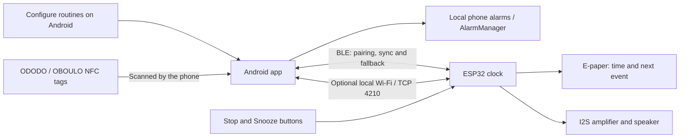
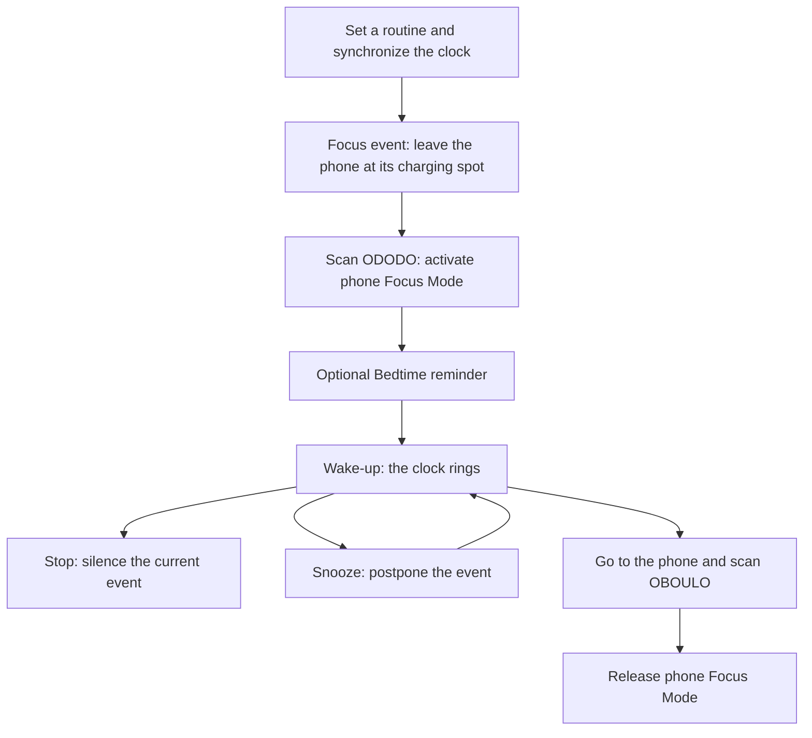

# How Clockinator works

[Back to the project](../README.md)

## One routine, two or three events

A Clockinator routine can contain these events:

1. **Focus**: starts the evening routine. The phone must ring; the alarm clock can ring too. Place the `ODODO` tag where you want to leave your phone, out of reach and preferably beside its charger.
2. **Bedtime** *(optional)*: a reminder to go to bed. It can ring on the phone, the alarm clock, or both. At least one output must be selected when it is enabled, so the alarm clock can be the primary output.
3. **Wake-up**: the morning alarm. The Clockinator must ring; the phone can ring as well. Place the `OBOULO` tag near the first action you want to take, such as going to the kitchen, balcony, or bathroom.

Configure events in the app and sync them to the clock. Routines can repeat daily, weekly, or at an interval of days. Each event can be skipped once from the app; the next event in chronological order is offered first.

### NFC tags

Tags contain an NDEF Text record with one of these values:

- `ODODO`: activates Focus Mode on the phone. If the app currently detects a ringing Focus or Bedtime event, scanning the tag stops it and sends the stop command to the clock. When no event is ringing, it toggles the next Focus occurrence's skip state.
- `OBOULO`: releases Focus Mode. If the app currently detects a ringing Wake-up event, scanning the tag stops it and sends the stop command to the clock. When no event is ringing, it toggles the next Wake-up occurrence's skip state.

You can program tags from the app's settings. Tags already written with these values also work. Common rewritable NDEF tags such as NTAG213, NTAG215, and NTAG216 are suitable.

> For a tag-triggered stop or skip to be mirrored to the alarm clock, BLE must be available. Currently, tags act on events tracked by the Android app; they do not independently detect an alarm that is ringing only on the ESP32.

## How it works

- **Android is the source of truth** for routines and recurrence. Phone alarms are scheduled locally with `AlarmManager` and do not depend on an internet connection.
- **The phone synchronizes routines, time, alarm actions, and ringtone uploads** over Wi-Fi when connected, with BLE available for pairing and fallback.
- **BLE remains available for pairing and fallback.** During setup, you can optionally enter a local Wi-Fi SSID and password; the app sends them to the ESP32 over BLE.
- **When configured, the ESP32 joins the Wi-Fi network** and opens a TCP server on port `4210`. Supported bands depend on the chip: classic ESP32 variants are generally 2.4 GHz only, while ESP32-C5 supports 2.4 and 5 GHz. The app connects to its address announced over BLE and falls back to BLE if TCP is unavailable.
- **The ESP32 calculates and displays the next event**, then plays a built-in melody or a WAV file uploaded from the app. It can notify the phone when an alarm is stopped, snoozed, or skipped so both devices stay in sync.
- **After the alarm clock restarts**, the phone sends routines again when BLE reconnects. The firmware keeps the routine list in RAM; it is not persisted to flash.
- **Android Focus Mode** can enable Do Not Disturb and, when the required system permission is available, grayscale. Pausing individual apps is configured through Digital Wellbeing; Android does not let this app pause apps directly without device-management privileges.

The project requires no account, cloud service, or internet access. Wi-Fi communication requires the phone and ESP32 to be on the same local network, with client-to-client traffic allowed. The ESP32 stores Wi-Fi credentials in NVS; the app does not persist them. Wi-Fi provisioning and TCP commands are currently not encrypted or authenticated, so use a trusted local network.

### System overview

The NFC tags are read by the **phone**, not by the ESP32. No cloud server is involved. Once time and routines have been synchronized, the powered clock can calculate and ring its own scheduled events while the phone is disconnected. Changes made on the phone still need a connection to reach the clock. After a clock restart, reconnect the phone to restore time and routines; do not rely on unsynchronized firmware as a standalone alarm.

### A typical evening and morning

Scanning a tag stops the matching event only when the Android app detects it as ringing. Otherwise, it toggles the next matching occurrence's skip state, as described above. The physical buttons also let you stop or snooze the clock without walking to the phone; NFC is a routine aid, not a compulsory unlock mechanism.

### Using the alarm clock

- **Stop** silences the current event and cancels its pending snooze. It does not delete the routine: the next scheduled occurrence remains available.
- **Snooze** uses the routine's configured snooze durations. Repeated presses cycle through those durations, including while a snooze is pending. With no configured duration, there is nothing to schedule.
- **Sound** comes from an uploaded WAV file or the built-in melody. The app provides five non-mute volume levels and a five-second preview; a scheduled alarm takes priority over a preview.
- **Light** can be switched on or off and its RGB colour configured from the app. The firmware retains the colour. The physical light button is currently disabled by `LIGHT_BUTTON_ENABLED = false`; enabling it requires wiring GPIO34 with an external pull-up.
- **Synchronization** mirrors clock stop and snooze actions to the phone when communication is available. While disconnected, the devices cannot immediately mirror each other's actions.

The routine list and pending snooze live in RAM. Wi-Fi credentials, volume, light colour and display refresh preferences are retained separately in flash. A power interruption therefore requires a fresh time/routine synchronization from the phone.

